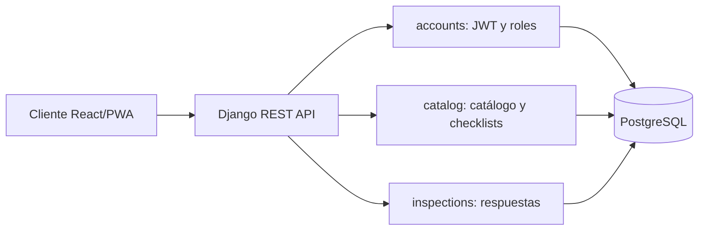

# Arquitectura

SIGOPE usa un monolito modular Django. Cada app representa un dominio y
expone modelos, serializadores y viewsets REST. La configuración transversal
vive en `config/`.

Las vistas reciben la petición, los serializadores validan el contrato y los
modelos mantienen integridad referencial. `simple-history` registra cambios
en usuarios, tipos, equipos, categorías, ítems y listas.
